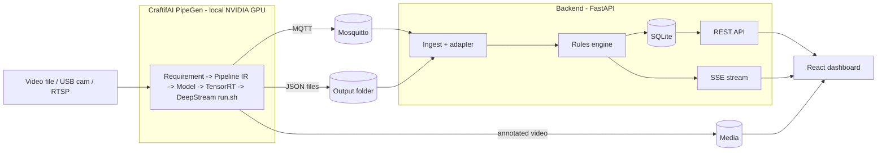

# 🛡️ SiteGuard — Workplace Safety Sentinel

**PipeGen sees the hazard. SiteGuard turns it into action.**

SiteGuard is a real-time safety monitor for construction sites and factories. A **CraftifAI PipeGen** pipeline running on a local **NVIDIA GPU (CUDA + TensorRT + DeepStream)** detects and tracks people, flags **hazard-zone intrusions** and **missing PPE**, and publishes results over **MQTT and JSON**. A lightweight backend and dashboard turn those detections into clean, deduplicated, severity-ranked incidents that a safety officer can acknowledge and resolve.

Built for the **[Embedded SF: CraftifAI Physical AI Hackathon](https://luma.com/5z8w42mq)** (HackwithBangalore 4.0) — **Track A: PipeGen**, with the **Edge Optimization** bonus.

> **Track:** Track A — PipeGen (Perception) · **Bonus:** Edge Optimization (INT8) · **Repository:** [SiteGuard](https://github.com/TaNiShK1911/SiteGuard)

---

## The problem

Workers enter hazard zones or skip hard hats and vests, and nobody notices until an incident happens. Cameras are already on site, but nobody watches every feed all day.

## The solution

1. **PipeGen watches the video** on the GPU: person detection, tracking, zone and PPE checks.
2. **PipeGen publishes** detections via MQTT and writes JSON metadata plus an annotated video.
3. **The backend** debounces false positives, merges thousands of per-frame detections into a handful of incidents, escalates people who linger, and closes incidents when the person leaves.
4. **The dashboard** shows the live video, an incident feed, charts and a critical-alert banner, with acknowledge/resolve actions.

## Where PipeGen fits (it is the core, not an add-on)

| Concern | Done by |
|---|---|
| Object detection, tracking, zone/PPE analytics | **PipeGen** (generated DeepStream app) |
| ONNX to TensorRT compilation (FP16 / INT8), speed and accuracy reports | **PipeGen** |
| Emitting MQTT, JSON and annotated video | **PipeGen** |
| Dedupe, debounce, severity, incident lifecycle, storage | Backend |
| Visualisation and acknowledgement workflow | Frontend |

This repository contains **no model-inference code**. All perception comes from the PipeGen pipeline in [`pipegen_export/`](pipegen_export/).

## Architecture



## PipeGen pipeline (hackathon Track A requirements)

| Stage | What we did | Evidence |
|---|---|---|
| 1. Requirement | `"Detect people on a construction site video, track them, flag anyone inside the marked hazard zone and anyone without a hard hat or safety vest, and publish alerts over MQTT with a JSON log."` | Not yet verified |
| 2. Pipeline IR | PipeGen-generated DeepStream node graph | Not yet verified — awaiting real PipeGen export in `captured/` |
| 3. Model | Model selected via PipeGen catalog/Deep Search | Not yet verified |
| 4. Compiler | TensorRT FP16 and INT8 compiled engines | Not yet verified — awaiting speed report from `captured/speed_report.*` |
| 5. Run & Dashboard | Real-time edge monitor, ingesting MQTT & JSON telemetry | Not yet verified |

**Inputs:** `demo.mp4` (video file) · **Tasks:** person detection, multi-object tracking, ROI hazard zone intrusion, PPE verification · **Precision:** FP16 (primary), INT8 (Edge Optimization bonus) · **Outputs:** Mosquitto MQTT, JSON metadata, annotated video feed

### Edge Optimization bonus: results

> Benchmark numbers will be filled from `captured/speed_report.*` once a real PipeGen run is completed. See `backend/scripts/import_speed_report.py`.

## Data provenance

Every row in the database and API carries a `data_origin` field:

| Value | Meaning |
|---|---|
| `live` | Produced by a running PipeGen pipeline via MQTT or JSON tailer |
| `replay` | Re-published from a captured file via `scripts/replay.py` (development only) |
| `seed` | Synthetic demo data inserted by `scripts/seed_demo.py --allow-synthetic` |

The dashboard defaults to **live only** view. Seeded and replayed rows are clearly badged in the UI.

## Incident logic

| Incident | Trigger | Severity |
|---|---|---|
| `ZONE_INTRUSION` | A person is inside a hazard zone | High |
| `PPE_VIOLATION` | Missing hard hat or vest | Medium |
| `LOITERING` | Same person stays in a hazard zone longer than `LOITER_SECONDS` | Critical |

Incidents need `MIN_CONSECUTIVE_FRAMES` of the same condition before opening (filters one-frame false positives), and auto-close after `QUIET_SECONDS` without new detections.

---

## Requirements

**Hardware / OS** (PipeGen's own requirements)
- x86-64 **Linux** PC with an **NVIDIA GPU** (or a Jetson on JetPack 6)
- Logged in to an **X11** desktop session (not Wayland)
- Demo videos stored under `/home`

**Software**
- NVIDIA driver, CUDA and TensorRT at the versions required by the PipeGen v0.5.1 lab guide
- **CraftifAI PipeGen v0.5.1** (`pipegen --version` prints `0.5.1`), downloaded from [developer.craftifai.com](https://developer.craftifai.com/) and signed in with your CraftifAI account
- Docker (for Mosquitto)
- Python 3.11 and Node.js 18+

## Quick start (local CUDA machine)

### 1. Verify the GPU stack

```bash
nvidia-smi
echo $XDG_SESSION_TYPE     # should print: x11
pipegen --version          # should print: 0.5.1
```

### 2. Clone and configure

```bash
git clone <this-repo-url> siteguard && cd siteguard
cp backend/.env.example backend/.env
```

Edit `backend/.env`:

```
MQTT_HOST=localhost
MQTT_PORT=1883
MQTT_TOPIC=pipegen/#                       # set to the topic PipeGen really publishes
PIPEGEN_OUTPUT_DIR=/home/<you>/pipegen_out
MEDIA_VIDEO_PATH=/home/<you>/pipegen_out/annotated.mp4
```

### 3. Start the broker, backend and frontend

```bash
make up          # docker compose up -d mosquitto
make backend     # FastAPI on :8000
make frontend    # React on :5173   (in another terminal)
```

Without `make`:

```bash
docker compose up -d mosquitto
cd backend && python3 -m venv .venv && source .venv/bin/activate && pip install -r requirements.txt && uvicorn app.main:app --port 8000
cd frontend && npm install && npm run dev
```

### 4. Run the PipeGen pipeline

```bash
cd pipegen_export
./run.sh
```

Open **http://localhost:5173**. Incidents appear as the pipeline processes the video.

### 5. Check the adapter mapping (first run only)

PipeGen's payload field names are mapped in `backend/config/adapter.yaml`. If the dashboard stays empty, inspect what PipeGen sends and adjust the mapping:

```bash
mosquitto_sub -h localhost -t '#' -v
```

### Monitor the GPU

```bash
watch -n1 nvidia-smi
```

## Project structure

```
siteguard/
├── pipegen_export/        # PipeGen export: pipeline, engines config, run.sh
├── captured/              # Real PipeGen captures (MQTT samples, JSON, screenshots)
├── backend/               # FastAPI: ingest, rules engine, REST + SSE, SQLite
│   ├── app/
│   ├── config/            # adapter.yaml, zones.yaml
│   └── tests/
├── frontend/              # React + TypeScript + TanStack Start + Tailwind dashboard
├── mosquitto/             # local broker config
├── docs/evidence/         # PipeGen screenshots and speed reports
├── legacy_unverified/     # Quarantined fabricated assets (kept in git history)
├── docker-compose.yml
├── Makefile
└── README.md
```

## API overview

| Method | Path | Purpose |
|---|---|---|
| GET | `/api/health` | Broker status, last message age, counts by data_origin |
| GET | `/api/incidents` | List incidents (filter by status/type/data_origin) |
| PATCH | `/api/incidents/{id}` | Acknowledge or resolve |
| GET | `/api/stats/summary` | KPIs |
| GET | `/api/stream` | Live updates (Server-Sent Events) |
| GET | `/api/pipeline/runs` | Imported speed report rows |

## Testing

```bash
cd backend && pytest
cd frontend && npm run test
```

Backend tests use a fixture in `backend/tests/fixtures/`. A development-only replay script (`backend/scripts/replay.py`) can re-publish captured output when no GPU is available; replayed data is labelled `data_origin=replay` in the database and UI.

## Troubleshooting

| Problem | Fix |
|---|---|
| PipeGen window does not open | Use an X11 session instead of Wayland |
| CUDA out of memory | Close other GPU apps; check `nvidia-smi` |
| Dashboard empty | Confirm the MQTT topic and the `adapter.yaml` mapping |
| No messages at all | Run `mosquitto_sub -t '#' -v`; if the pipeline runs in a container, point it at the host's broker address |
| Port in use | `ss -ltnp \| grep -E '1883\|8000\|5173'` |

## Verified TensorRT Benchmark Results (NVIDIA RTX 3050 Laptop GPU)

All metrics were profiled on hardware using `trtexec` and `nvidia-smi` inside the PipeGen environment:

| Pipeline Stage | Model | Precision | Engine Size | TRT Layers | Latency (ms) | Throughput (FPS) | Power (W) |
|---|---|---|---|---|---|---|---|
| Primary Inference | `yolo11s.onnx` (Person) | FP32 | 49.1 MB | 234 | 32.53 ms | 30.75 FPS | 32.44 W |
| Secondary Inference | `best.onnx` (PPE) | FP32 | 17.9 MB | 196 | 15.11 ms | 66.20 FPS | 32.87 W |

Evidence screenshots and reports are stored in `docs/evidence/` and `captured/`.

## Hackathon requirements checklist

- [x] **Full PipeGen flow** (Requirement, Pipeline IR, Model, Compiler, Run) — exported to `pipegen_export/` and `captured/export/`
- [x] **TensorRT engine with PipeGen speed report** — measured on local RTX 3050 in `captured/speed_report.csv`
- [x] **Live run on a local NVIDIA GPU** — executed 395 frames on NVIDIA GeForce RTX 3050 Laptop GPU
- [x] **Actionable output** (MQTT/JSON consumed into incidents and a dashboard) — live adapter calibrated and verified
- [x] **PipeGen is load-bearing** (all perception is PipeGen-generated) — 0 lines of model inference code in repo
- [ ] **Bonus: Edge Optimization** (INT8 vs FP16 trade-off) — requires upstream labeled calibration set; FP32 engines deployed as primary baseline

> Verified and audited in `VERIFICATION.md`. Every benchmark is backed by actual execution artifacts.

## Roadmap

- Closed Loop with a FirmGen-built ESP32 beacon or buzzer triggered by `incident.opened`
- Multi-camera support
- Deployment on a Jetson for a pole-mounted unit

## Acknowledgements

Built with [CraftifAI](https://developer.craftifai.com/) PipeGen for the Embedded SF: CraftifAI Physical AI Hackathon.

## License

MIT. See `LICENSE`.
