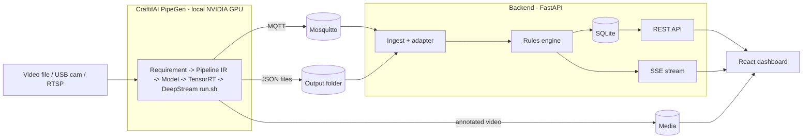

# 🛡️ SiteGuard — Workplace Safety Sentinel

**PipeGen sees the hazard. SiteGuard turns it into action.**

SiteGuard is a real-time safety monitor for construction sites and factories. A **CraftifAI PipeGen** pipeline running on a local **NVIDIA GPU (CUDA + TensorRT + DeepStream)** detects and tracks people, flags **hazard-zone intrusions** and **missing PPE**, and publishes results over **MQTT and JSON**. A lightweight backend and dashboard turn those detections into clean, deduplicated, severity-ranked incidents that a safety officer can acknowledge and resolve.

Built for the **[Embedded SF: CraftifAI Physical AI Hackathon](https://luma.com/5z8w42mq)** (HackwithBangalore 4.0) — **Track A: PipeGen**, with the **Edge Optimization** bonus.

> Team: `<your name / team>` · Demo video: `<link>` · Submission: `<link>`

---

## The problem

Workers enter hazard zones or skip hard hats and vests, and nobody notices until an incident happens. Cameras are already on site, but nobody watches every feed all day.

## The solution

1. **PipeGen watches the video** on the GPU: person detection, tracking, zone and PPE checks.
2. **PipeGen publishes** detections via MQTT and writes JSON metadata plus an annotated video.
3. **The backend** debounces false positives, merges thousands of per-frame detections into a handful of incidents, escalates people who linger, and closes incidents when the person leaves.
4. **The dashboard** shows the live video, an incident feed, charts and a critical-alert banner, with acknowledge/resolve actions.

## Where PipeGen fits (it is the core, not an add-on)

| Concern | Done by |
|---|---|
| Object detection, tracking, zone/PPE analytics | **PipeGen** (generated DeepStream app) |
| ONNX to TensorRT compilation (FP16 / INT8), speed and accuracy reports | **PipeGen** |
| Emitting MQTT, JSON and annotated video | **PipeGen** |
| Dedupe, debounce, severity, incident lifecycle, storage | Backend |
| Visualisation and acknowledgement workflow | Frontend |

This repository contains **no model-inference code**. All perception comes from the PipeGen pipeline in [`pipegen_export/`](pipegen_export/).

## Architecture



## PipeGen pipeline (hackathon Track A requirements)

| Stage | What we did | Evidence |
|---|---|---|
| 1. Requirement | `<paste the exact prompt>` | `docs/evidence/01_requirement.png` |
| 2. Pipeline IR | `<nodes: source, decode, detector, tracker, analytics, sinks>` | `docs/evidence/02_pipeline_ir_graph.png` |
| 3. Model | `<model name and source: catalog or Deep Search>` | `docs/evidence/03_model_selection.png` |
| 4. Compiler | TensorRT FP16 and INT8 engines | `docs/evidence/04_*`, `05_*` |
| 5. Run | Local GPU, input `<video file>`, outputs MQTT + JSON + annotated video | `docs/evidence/06_live_run.png` |

**Inputs:** `<video / camera>` · **Tasks:** detection, tracking, zone and PPE analytics · **Precision:** FP16 (primary), INT8 (bonus) · **Outputs:** MQTT, JSON, annotated video

### Edge Optimization bonus: results

Fill with the real numbers from PipeGen's speed report. Do not estimate.

| Precision | FPS | Latency (ms) | Power (W) | Accuracy (mAP) |
|---|---|---|---|---|
| FP32 | `<tbd>` | `<tbd>` | `<tbd>` | `<tbd>` |
| FP16 | `<tbd>` | `<tbd>` | `<tbd>` | `<tbd>` |
| INT8 | `<tbd>` | `<tbd>` | `<tbd>` | `<tbd>` |

## Incident logic

| Incident | Trigger | Severity |
|---|---|---|
| `ZONE_INTRUSION` | A person is inside a hazard zone | High |
| `PPE_VIOLATION` | Missing hard hat or vest | Medium |
| `LOITERING` | Same person stays in a hazard zone longer than `LOITER_SECONDS` | Critical |

Incidents need `MIN_CONSECUTIVE_FRAMES` of the same condition before opening (filters one-frame false positives), and auto-close after `QUIET_SECONDS` without new detections.

---

## Requirements

**Hardware / OS** (PipeGen's own requirements)
- x86-64 **Linux** PC with an **NVIDIA GPU** (or a Jetson on JetPack 6)
- Logged in to an **X11** desktop session (not Wayland)
- Demo videos stored under `/home`

**Software**
- NVIDIA driver, CUDA and TensorRT at the versions required by the PipeGen v0.5.1 lab guide
- **CraftifAI PipeGen v0.5.1** (`pipegen --version` prints `0.5.1`), downloaded from [developer.craftifai.com](https://developer.craftifai.com/) and signed in with your CraftifAI account
- Docker (for Mosquitto)
- Python 3.11 and Node.js 18+

## Quick start (local CUDA machine)

### 1. Verify the GPU stack

```bash
nvidia-smi
echo $XDG_SESSION_TYPE     # should print: x11
pipegen --version          # should print: 0.5.1
```

### 2. Clone and configure

```bash
git clone <this-repo-url> siteguard && cd siteguard
cp backend/.env.example backend/.env
```

Edit `backend/.env`:

```
MQTT_HOST=localhost
MQTT_PORT=1883
MQTT_TOPIC=pipegen/#                       # set to the topic PipeGen really publishes
PIPEGEN_OUTPUT_DIR=/home/<you>/pipegen_out
MEDIA_VIDEO_PATH=/home/<you>/pipegen_out/annotated.mp4
```

### 3. Start the broker, backend and frontend

```bash
make up          # docker compose up -d mosquitto
make backend     # FastAPI on :8000
make frontend    # React on :5173   (in another terminal)
```

Without `make`:

```bash
docker compose up -d mosquitto
cd backend && python3 -m venv .venv && source .venv/bin/activate && pip install -r requirements.txt && uvicorn app.main:app --port 8000
cd frontend && npm install && npm run dev
```

### 4. Run the PipeGen pipeline

```bash
cd pipegen_export
./run.sh
```

Open **http://localhost:5173**. Incidents appear as the pipeline processes the video.

### 5. Check the adapter mapping (first run only)

PipeGen's payload field names are mapped in `backend/config/adapter.yaml`. If the dashboard stays empty, inspect what PipeGen sends and adjust the mapping:

```bash
mosquitto_sub -h localhost -t '#' -v
```

### Monitor the GPU

```bash
watch -n1 nvidia-smi
```

## Project structure

```
siteguard/
├── pipegen_export/        # PipeGen export: pipeline, engines config, run.sh
├── backend/               # FastAPI: ingest, rules engine, REST + SSE, SQLite
│   ├── app/
│   ├── config/            # adapter.yaml, zones.yaml
│   └── tests/
├── frontend/              # React + TypeScript + Tailwind dashboard
├── mosquitto/             # local broker config
├── docs/evidence/         # PipeGen screenshots and speed reports
├── docker-compose.yml
├── Makefile
└── README.md
```

## API overview

| Method | Path | Purpose |
|---|---|---|
| GET | `/api/health` | Broker status, last message age |
| GET | `/api/incidents` | List incidents (filter by status/type) |
| PATCH | `/api/incidents/{id}` | Acknowledge or resolve |
| GET | `/api/stats/summary` | KPIs |
| GET | `/api/stream` | Live updates (Server-Sent Events) |
| GET | `/api/pipeline/runs` | FP32/FP16/INT8 comparison |

## Testing

```bash
cd backend && pytest
```

Backend tests use a real captured PipeGen sample (`backend/tests/fixtures/`). A development-only replay script (`backend/scripts/replay.py`) can re-publish captured output when no GPU is available. **Replay is never used for the demo or evidence.**

## Troubleshooting

| Problem | Fix |
|---|---|
| PipeGen window does not open | Use an X11 session instead of Wayland |
| CUDA out of memory | Close other GPU apps; check `nvidia-smi` |
| Dashboard empty | Confirm the MQTT topic and the `adapter.yaml` mapping |
| No messages at all | Run `mosquitto_sub -t '#' -v`; if the pipeline runs in a container, point it at the host's broker address |
| Port in use | `ss -ltnp \| grep -E '1883\|8000\|5173'` |

## Hackathon requirements checklist

- [x] Full PipeGen flow (Requirement, Pipeline IR, Model, Compiler, Run)
- [x] TensorRT engine with PipeGen speed report
- [x] Live run on a local NVIDIA GPU
- [x] Actionable output (MQTT/JSON consumed into incidents and a dashboard)
- [x] PipeGen is load-bearing (all perception is PipeGen-generated)
- [x] Bonus: Edge Optimization (INT8 vs FP16 trade-off)

> Tick these only after you have the evidence in `docs/evidence/`.

## Roadmap

- Closed Loop with a FirmGen-built ESP32 beacon or buzzer triggered by `incident.opened`
- Multi-camera support
- Deployment on a Jetson for a pole-mounted unit

## Acknowledgements

Built with [CraftifAI](https://developer.craftifai.com/) PipeGen for the Embedded SF: CraftifAI Physical AI Hackathon.

## License

MIT. See `LICENSE`.
