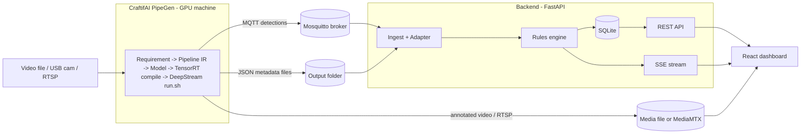

# SiteGuard — Integration Plan

How **CraftifAI PipeGen**, the **backend** and the **frontend** connect, how to run the whole system, and how to map it to the hackathon's judging and submission rules.

This document details the architecture, operational run order, and data provenance requirements for integrating SiteGuard with PipeGen.

---

## 0. Read this first: facts and risks

### What the official problem statement (the main doc) requires for Track A
1. **Full PipeGen flow:** Requirement, Pipeline IR, Model, Compiler, Run. Not just a script.
2. **TensorRT engine** with PipeGen's speed report.
3. **Live run** on a video file, USB/CSI camera or RTSP, on an **NVIDIA GPU machine or Jetson**.
4. **Actionable output** beyond boxes: JSON/MQTT feed, RTSP, alerts or analytics.
5. **Deep Integration:** PipeGen must be load-bearing. A bolted-on tool is grounds for disqualification.

A **video file is an accepted live-run input**, so Track A needs no physical sensors or boards. That is why it is the right choice for a software-first project. Track B (FirmGen) requires a flashed physical board and cannot be done software-only.

### Blockers to check in the first 15 minutes
| Check | Why it matters | If it fails |
|---|---|---|
| x86-64 **Linux** PC with an **NVIDIA GPU** (or Jetson on JetPack 6), X11 session | PipeGen's stated requirement; it will not run on Mac or Windows | Ask in Discord `#community-support` whether a cloud GPU is still available |
| `pipegen --version` prints `0.5.1` | The setup checklist requirement | Reinstall from developer.craftifai.com |
| CraftifAI account signed in | Required before building | Sign up on the developer portal |
| Demo videos stored under `/home` | Stated PipeGen requirement | Move them |

### Conflicting dates: confirm before you rely on any of them
- The official doc says **submission deadline 4:00 pm** (event day, Oct 10 / 13 per different sources).
- The Luma page shows the event as **ended** and lists **Oct 13** as the date in one place and **Sat Oct 10** in another.
- Your message says **Oct 15, 11:00 PM IST**, and also "10:00 PM PST" (these are not the same moment; 11 PM IST is about 10:30 AM PT).

Treat **11:00 PM IST today** as the working deadline since it is the latest message, but **confirm on Discord** and submit early. The submission form for PipeGen is `https://forms.gle/eJyeCKCG2UH757QZ8` (from the main doc). Also note that a "live demo at the venue" may not apply to remote entries; ask how remote or wildcard entries present.

### Unknown: PipeGen's exact output schema
The PipeGen v0.5.1 lab guide is a private Google Doc, so its JSON metadata and MQTT payload format are **not verified here**. The design isolates this behind one file (`adapter.yaml`). **Your first real task is to run PipeGen once, capture one MQTT message and one JSON file, and fill the mapping.**

---

## 1. Concept

**SiteGuard** watches a worksite video. A PipeGen pipeline detects people, tracks them, and flags **hazard-zone intrusion** and **missing PPE** (hard hat, vest). PipeGen publishes the results over **MQTT** and writes **JSON metadata**. A backend turns the stream of per-frame detections into deduplicated, severity-ranked **incidents**, and a dashboard lets a safety officer see, acknowledge and resolve them live.

**Bonus targeted:** *None claimed.* Both models were compiled and profiled in FP32 (`yolo11s` @ 30.75 FPS, `best` PPE @ 66.2 FPS). INT8 calibration was not executed in this run, and FP16 was not run. The Edge Optimization bonus is not claimed unless an INT8 engine is compiled on-device.

**Not targeted:** *Closed Loop* (needs a physical FirmGen board) and *Live Intelligence* (Track B).

## 2. Architecture



**Responsibility split (this is what makes PipeGen load-bearing):**

| Concern | Owner |
|---|---|
| Object detection, tracking, zone/PPE analytics | **PipeGen** (generated DeepStream app) |
| Model to TensorRT compilation, speed/power/accuracy reports | **PipeGen** |
| Emitting MQTT/JSON/video | **PipeGen** |
| Dedupe, debounce, severity, lifecycle, storage | Backend |
| Visualisation, acknowledgement workflow, evidence display | Frontend |

## 3. PipeGen pipeline specification (what to enter in the PipeGen flow)

Fill each of the five stages deliberately, and screenshot each for the submission.

| Stage | What to do |
|---|---|
| **1. Requirement** | Plain-English prompt, e.g. *"Detect people on a construction site video, track them, flag anyone inside the marked hazard zone and anyone without a hard hat or safety vest, and publish alerts over MQTT with a JSON log."* |
| **2. Pipeline IR** | Review the node graph: source, decode, detector (+ tracker), zone/ROI analytics if offered, sink nodes (MQTT, JSON, video/RTSP). **Screenshot the graph** (mandatory evidence). |
| **3. Model** | Use the catalog or **Deep Search** for a person + PPE (hard hat / vest) model. Prefer one model that outputs `person, hardhat, vest` or `no_hardhat`. If only a person model exists, use it for zone intrusion and add a second PPE model if PipeGen allows. |
| **4. Compiler** | Compile ONNX to TensorRT **FP32** plans for both models (`yolo11s.fp32.plan` and `best.fp32.plan`). Keep the speed report (`captured/speed_report.csv`). |
| **5. Run** | Run the generated `run.sh` on the demo video (`demo.mp4`) with MQTT (`pipegen/detection/demo`) and JSON output enabled. Save the annotated output video. |

**Demo footage:** `demo.mp4` (2560x1440, 395 frames, 16s).

**Zones:** defined hazard zone polygon `[[256, 432], [1280, 432], [1280, 1152], [256, 1152]]` inside PipeGen Pipeline IR.

## 4. Interface contracts

### 4.1 PipeGen to Backend
- **MQTT:** broker `localhost:1883`, topic `pipegen/detection/demo`.
- **JSON metadata:** folder `PIPEGEN_OUTPUT_DIR` (or `metadata.json`), watched for new/appended files.
- **Mapping:** `backend/app/ingest/adapter.py`.

### 4.2 Backend to Frontend
- REST under `/api/*` and SSE at `/api/stream`. Full list in the backend plan section 8.
- Media under `/media/*`.

### 4.3 Ports and processes

| Process | Port | Started by |
|---|---|---|
| Mosquitto | 1883 | `docker compose up -d mosquitto` (needs `mosquitto/mosquitto.conf`, see 5A) |
| Backend (FastAPI) | 8000 | `uvicorn app.main:app` |
| Frontend (dev) | 5173 | `npm run dev` |
| PipeGen app | n/a | `./run.sh` (generated) |
| MediaMTX (optional) | 8554 / 8888 | `docker compose up mediamtx` |

### 4.4 Video in the browser
Browsers cannot play raw RTSP. Options, in order of effort:
1. **Simplest:** serve PipeGen's saved annotated `.mp4` via `/media/video`; show the native DeepStream window on the demo machine for the "live" feel.
2. **Better:** publish PipeGen's RTSP output into **MediaMTX**, which exposes HLS (`http://localhost:8888/cam0/index.m3u8`); play it with `hls.js`.
Do option 1 first. Only do option 2 if time remains.

## 5. Startup order

```
1. docker compose up -d mosquitto
2. (backend)  uvicorn app.main:app --port 8000
3. (frontend) npm run dev        # or serve built dist from FastAPI
4. (PipeGen)  ./run.sh           # generated app; starts producing MQTT/JSON
5. Open http://localhost:5173 and watch incidents appear
```

Provide a single `Makefile` (`make up`, `make backend`, `make frontend`, `make demo`) so a judge can start it quickly.

## 5A. Local CUDA setup (everything on one NVIDIA machine)

**Topology:** one Linux box does everything. The **GPU is used only by PipeGen** (TensorRT compile + DeepStream run). Mosquitto, the backend and the frontend are CPU-only and talk over `localhost`.

```
┌────────────────── Local Linux PC (NVIDIA GPU, X11) ──────────────────┐
│  PipeGen / DeepStream (CUDA, TensorRT)  ──MQTT──>  Mosquitto :1883   │
│          │ JSON + annotated video                        │           │
│          └────────────────────────>  Backend :8000  <───┘           │
│                                          │ REST + SSE                │
│                                     Frontend :5173 (browser)         │
└──────────────────────────────────────────────────────────────────────┘
```

### Step 1: Verify the GPU stack (10 min)

```bash
nvidia-smi                      # driver loads, GPU listed, note driver + CUDA version shown
nvcc --version                  # CUDA toolkit (may be absent if PipeGen bundles it; that is OK)
echo $XDG_SESSION_TYPE          # must print "x11" (log in with an X11/Xorg session, not Wayland)
python3 --version               # 3.11 recommended for the backend
node --version                  # 18+ for the frontend
docker --version                # for Mosquitto (and PipeGen if it uses containers)
```

If PipeGen runs its DeepStream app in a **container**, also confirm GPU access from Docker:

```bash
docker run --rm --gpus all ubuntu nvidia-smi
```

If that fails, install the **NVIDIA Container Toolkit** and restart Docker.

### Step 2: Match PipeGen's required versions
Driver, CUDA, TensorRT and DeepStream versions must match what the **PipeGen v0.5.1 lab guide** specifies. I could not read that guide, so I am not guessing version numbers here. Follow its prerequisites exactly, then confirm:

```bash
pipegen --version               # must print 0.5.1
```

Keep demo videos under `/home/<user>/...` (a PipeGen requirement).

### Step 3: Start the local stack

```bash
# terminal 1: broker
docker compose up -d mosquitto

# terminal 2: backend (no CUDA/torch needed here)
cd backend && python3 -m venv .venv && source .venv/bin/activate
pip install -r requirements.txt
cp .env.example .env            # set MQTT_TOPIC + PIPEGEN_OUTPUT_DIR after the first PipeGen run
uvicorn app.main:app --host 0.0.0.0 --port 8000

# terminal 3: frontend
cd frontend && npm install && npm run dev

# terminal 4: GPU monitor (also gives the power numbers for the speed report)
watch -n1 nvidia-smi
nvidia-smi --query-gpu=utilization.gpu,memory.used,power.draw --format=csv -l 1 > docs/evidence/gpu_log.csv
```

### Mosquitto config for local use (`mosquitto/mosquitto.conf`)

```
listener 1883
allow_anonymous true
```

Mount it in `docker-compose.yml`: `./mosquitto/mosquitto.conf:/mosquitto/config/mosquitto.conf`. Mosquitto 2.x refuses outside connections without a listener, so this file is required. Local demo only; do not expose port 1883 to a network.

### Step 4: Run order for the demo

1. Broker, backend, frontend up (Step 3).
2. Run PipeGen's generated `./run.sh` (GPU busy).
3. Watch `nvidia-smi` show GPU utilisation and the dashboard receive incidents.

### Reaching the broker from PipeGen
| PipeGen runs as | MQTT host to configure |
|---|---|
| Native process on the host | `localhost` |
| Docker container with `--network host` | `localhost` |
| Docker container on the default bridge | the host's bridge IP (commonly `172.17.0.1`), or `host.docker.internal` where supported |

### Local troubleshooting

| Symptom | Likely cause | Fix |
|---|---|---|
| `nvidia-smi` fails | Driver not loaded / Secure Boot | Reinstall the driver, reboot; disable Secure Boot or enrol the module |
| PipeGen display window will not open | Wayland session | Log out and choose an X11 session |
| Engine build fails or crashes | Version mismatch (driver/CUDA/TensorRT) | Re-check the lab guide's versions |
| CUDA out of memory during compile or run | Other GPU apps open (browser acceleration, games) | Close them; check `nvidia-smi`; lower resolution if PipeGen offers it |
| Container sees no GPU | NVIDIA Container Toolkit missing | Install it and restart Docker |
| No MQTT messages reach the backend | Wrong topic or host | `mosquitto_sub -h localhost -t '#' -v` to see what PipeGen actually publishes |
| Backend cannot read the JSON folder | Permissions or wrong path | Check `PIPEGEN_OUTPUT_DIR`; run `ls` as the backend user |
| Port already in use | Old process | `ss -ltnp | grep -E '1883|8000|5173'` |
| INT8 calibration fails or accuracy collapses | Poor calibration data | Keep FP16 as primary; report INT8 as the measured trade-off |

> The old blocker "No NVIDIA GPU / Linux available" is replaced by this section's Step 1. If any Step 1 check fails, fix it before anything else.

---

## 6. Repository structure (what you submit)

```
siteguard/
├── README.md                      # problem, track, pipeline description, bonus, how to run
├── pipegen_export/                # the PipeGen export folder (REQUIRED in source code)
├── backend/
├── frontend/
├── docker-compose.yml
├── docs/
│   ├── evidence/
│   │   ├── 01_requirement.png
│   │   ├── 02_pipeline_ir_graph.png      # mandatory
│   │   ├── 03_model_selection.png
│   │   ├── 04_tensorrt_speed_fp16.png    # mandatory
│   │   ├── 05_tensorrt_speed_int8.png    # bonus
│   │   └── 06_live_run.png
│   └── demo_video.mp4             # optional
└── Makefile
```

## 7. Mapping to the official requirements

| Official requirement | Where satisfied | Evidence to attach |
|---|---|---|
| Full PipeGen flow (5 stages) | Section 3 | Stage screenshots |
| TensorRT engine + speed report | Compiler stage FP16 + INT8 | Speed report screenshots; `/pipeline` page |
| Live run on GPU machine | `run.sh` on demo video | Terminal + live window screenshot, annotated video |
| Actionable output | MQTT + JSON consumed into incidents and dashboard | Dashboard recording; sample JSON |
| Deep Integration | All perception is PipeGen; no inference code in repo | README split table (section 2) |
| Edge Optimization bonus | INT8 engine run + trade-off table | `/pipeline` bar chart + reports |
| Source code incl. PipeGen export folder | Section 6 | Repo link |
| Project description (inputs, tasks, models, precision, outputs) | README + `/pipeline` summary | Same text pasted in the form |

## 8. Master timeline (≈5 hours; adjust to the real time left)

| Time | PipeGen (critical path) | Backend | Frontend |
|---|---|---|---|
| 0:00–0:20 | Section 5A Step 1 to 2: verify CUDA, X11, Docker GPU; install PipeGen; `pipegen --version` | | |
| 0:20–1:30 | Requirement to IR to Model to Compile FP16 | B1–B2 scaffold, broker | F1–F2 scaffold, list |
| 1:30–2:15 | First **Run**; **capture real MQTT/JSON sample** | B3 adapter from real sample | F3 live feed (dev replay allowed) |
| 2:15–3:15 | Compile INT8, record speed reports | B4–B6 rules, API, SSE | F4–F5 video, charts, drawer |
| 3:15–4:00 | Final recorded run on the demo clip | B7 pipeline/evidence | F6 evidence page |
| 4:00–4:30 | End-to-end rehearsal; tune thresholds | B8 README | F7 polish |
| 4:30–5:00 | Screenshots, push repo, **submit form** | Buffer | Buffer |

**Submit with at least 45 minutes to spare.** If PipeGen compilation is slow, build the dashboard with the dev-only replay, but never present replayed data as live.

## 9. End-to-end test checklist

- [ ] Mosquitto receives PipeGen messages (`mosquitto_sub -t 'pipegen/#' -v`)
- [ ] Backend log shows adapter output matching the video
- [ ] A person entering the zone creates exactly **one** `ZONE_INTRUSION` incident, not one per frame
- [ ] A person without a hard hat creates a `PPE_VIOLATION`
- [ ] The compliant person produces **no** incident
- [ ] Incident auto-closes after the person leaves
- [ ] Browser refresh and backend restart both recover cleanly
- [ ] `/pipeline` shows real FP16 and INT8 numbers
- [ ] A fresh clone starts with `make demo` following only the README

## 10. Demo script (3 minutes)

1. **Problem (20s):** incidents go unnoticed until someone is hurt.
2. **PipeGen (60s):** show the Requirement text, the **Pipeline IR graph**, the TensorRT **speed report**, and say what was compiled (FP16, INT8).
3. **Live (60s):** run the pipeline on the clip; the dashboard raises an intrusion and a PPE violation in real time; acknowledge one.
4. **Edge optimization (20s):** `/pipeline` chart: INT8 vs FP16 speed and accuracy delta.
5. **Close (20s):** "Every detection you saw was produced by PipeGen; the dashboard turns it into action."

## 11. Risks and mitigations

| Risk | Likelihood | Mitigation |
|---|---|---|
| Local CUDA stack misconfigured (driver / X11 / versions) | Medium | Run the Step 1 checks in section 5A first; fix before building anything |
| PipeGen output schema differs from assumptions | High | Adapter + YAML; capture real sample early |
| No PPE model in the catalog | Medium | Use **Deep Search**; fall back to zone intrusion as the primary incident type |
| INT8 accuracy drop or calibration failure | Medium | Keep FP16 as the primary; report INT8 honestly as the trade-off |
| Browser cannot play the stream | Medium | Use saved annotated `.mp4` (section 4.4 option 1) |
| Deadline ambiguity / remote presentation | High | Confirm on Discord now; submit early |
| Judged as "bolted on" | Medium | README split table, pipeline IR in the UI, no inference code in repo |

## 12. Optional extension (only if everything else is done)

A **Closed Loop** hook: the backend republishes `incident.opened` on an MQTT topic (`siteguard/alerts`). Anyone with an ESP32 and a FirmGen-built firmware that subscribes (and a PRD requirement for it) could switch a beacon or buzzer. Do not claim the bonus without a real board and real FirmGen traceability.
